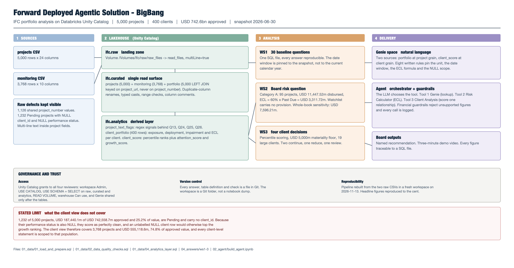

# BigBang - Forward Deployed: Agentic Innovation Challenge

Accenture x BTA, submission for **Team BigBang**, 15 November 2026.

A working analysis of a synthetic IFC portfolio: 5,000 projects, 400 clients,
USD 742.6 billion approved, as of the 2026-06-30 snapshot. Three workstreams,
one agent, and a set of findings that a Board can act on without asking how
the numbers were produced.

---

## What is in here

| Folder | What it holds |
|---|---|
| `00_setup/` | Environment bootstrap and the reviewer access grants |
| `01_data/` | Load, data quality checks, column comments, derived analytics layer |
| `02_agent/` | The agent notebook: three tools, orchestrator, guardrails, evaluation |
| `03_demo/` | Demo materials |
| `04_answers/` | WS1 (30 questions), WS2 (Board risk question), WS3 (client recommendation) |
| `assets/` | Architecture diagram, generated from `assets/_build_arch.py` |

---

## The architecture

Four lanes, and the line that matters is the one through `ifc.curated`. Two raw
CSVs land in a volume, become three Delta tables, and every question in WS1,
WS2 and WS3 reads the same joined table. A question cannot disagree with
another question because the two read different sources.

`ifc.analytics` is where derived judgement lives: regex text flags, the client
roll-up, and the percentile scores behind WS3. Everything above it is
reproducible SQL; everything below it is the raw file untouched.

---

## The headlines

**Two thirds of the approved capital has never been drawn.** Of USD 742.6
billion approved, USD 296.7 billion is disbursed and USD 445.9 billion is not.
Forty-two per cent of that undrawn balance, USD 187.4 billion, sits in 1,232
projects that are still Pending and have no client assigned at all. The
capital is not stuck in a relationship that has gone bad; it is stuck before a
relationship exists.

**Default is concentrated, and the clean names are scarce.** Above a
materiality floor of USD 5,000 million approved there are 19 clients holding
46.6% of the book. Only **three** of them carry no Past Due project, no
Watchlist project and no exit at a loss. The recommendation names two of those
three for growth and two impaired names for action.

**Category A carries more loss than its share of capital.** Category A projects
are 38.8% of impaired disbursed capital and 43.6% of expected credit loss. The
ratio is 1.12, not the multiple the raw ECL figures suggest. The gap is small
but it is in the direction the Board cares about.

---

## WS2 - the Board risk question

Scope is Category A, as the question requires.

| Population | Projects | Disbursed | Expected credit loss |
|---|---|---|---|
| **Category A (question scope)** | 95 | 11,447.52 | **3,311.72** |
| All projects (sensitivity) | 255 | 29,509.43 | 7,596.21 |

ECL is 60% of the disbursed balance of Past Due projects. Watchlist projects
carry no provision, because the case brief says the provision covers losses on
those that are Past Due. Reading Watchlist into the calculation would add a
provision the question does not ask for.

The second row is the honest context: restricting to Category A removes 56% of
the expected loss. A reader who only sees the first row will underestimate the
book by USD 4,284 million.

---

## WS3 - the four clients

| | Client | Action | Approved | Undisbursed |
|---|---|---|---|---|
| 1 | **Rosar Telecom Holdings** | Continue to invest | 6,283 | 2,704 |
| 2 | **Zansorzen Renewables Corp** | Continue to invest | 5,040 | 2,176 |
| 3 | **Wenharval Renewables Corp** | Reduce exposure | 5,544 | 2,058 |
| 4 | **Mijul Farms PLC** | Place under review | 15,927 | 6,657 |

The full reasoning, the scoring method and the defence of each name is in
`04_answers/ws3/README.md`. Two points belong here:

- The two reduction names are **not** the first two rows of one ranking.
  Wenharval ranks first on attention score and is the quality case. Mijul ranks
  seventh and is the size case, USD 6,657 million still to disburse. Ranking
  both on the same column would have produced two names saying one thing.
- A client that has already lost money cannot be a growth story. The growth
  list therefore requires a completely clean record, which is why it has only
  three names rather than ten.

---

## How to run it

Run in this order. Each script is safe to re-run.

| Step | Script | Result |
|---|---|---|
| 1 | `00_setup/00_config.sql` | Catalog `ifc`, schemas `raw`, `curated`, `analytics`, landing volume |
| 2 | `01_data/01_load_and_prepare.sql` | `projects` (5,000), `monitoring` (3,768), `portfolio` (5,000) |
| 3 | `01_data/02_data_quality_checks.sql` | `ifc.curated.data_quality_checks` |
| 4 | `01_data/03_add_comments.sql` | Table and column comments for Genie |
| 5 | `01_data/04_analytics_layer.sql` | `config_params`, `projects_excl_dropped`, `project_text_flags` |
| 6 | `04_answers/ws1/01_ws1_answers.sql` | All 30 questions, one block per question |
| 7 | `04_answers/ws2/01_ws2_answers.sql` | Two Board answers plus the sensitivity |
| 8 | `04_answers/ws3/01` then `02` then `03` | `client_portfolio`, then `client_score`, then the four names |
| 9 | `00_setup/05_grant_reviewers.sql` | Catalog, schema and volume grants for the four reviewers |

Every answer reads `ifc.curated.portfolio`, the project table joined to
monitoring. One read surface for all three workstreams, so no two answers can
disagree because they read different tables. `projects` and `monitoring` remain
the inputs; the join is one to one on `project_url`, 5,000 rows either way.

**Checkpoint after step 2.** The four counts must be 5,000 projects, 3,768
monitoring rows, 5,000 portfolio rows and 1,232 unmatched. The monitoring file
covers only projects that reached a client, which is why the third number is
the whole book and the second is not.

---

## Assumptions register

Where the questions or the data are ambiguous, these rules are applied in every
answer. Each answer file lists the IDs it depends on.

| ID | Rule | Effect on figures |
|---|---|---|
| A-01 | **A project is approved when `approval_date` is not NULL. Status is not used to decide this.** The data dictionary says the approval date is blank only if the project is not yet approved. Status decides only the status questions (Q15, Q23). Used by Q1, Q5, Q9, Q10, Q12, Q17, Q20, Q22. | 663 Pending projects have an approval date and count as approved. They are 663 of the 1,595 projects in Q1's window, with $21.1B of its $52.4B loan total. Deciding by status instead would make Q1 $31.3B and Q12 889 rows instead of 237. |
| A-02 | `project_url` is the only project key. `project_number` is display only and is never used to join, group or deduplicate. | 1,126 project numbers are shared across 2,567 unrelated projects. |
| A-03 | Reference date is the latest As of Date, 2026-06-30 (`ifc.analytics.config_params`). "Last 5 years" means `approval_date` after 2021-06-30 and up to 2026-06-30. Q10 and Q20 use the fixed calendar years 2020 to 2025. Q12 compares each row's own As of Date. | Answers do not change with the day they are run. 2026 is a partial year (approvals run to 2026-06-27). |
| A-04 | "Excluding Dropped" is applied once, through the view `ifc.analytics.projects_excl_dropped`. Q1 and Q17 do not say "excluding Dropped", so they include Dropped projects that have an approval date (Q1 also shows the alternative). | Q3, Q8, Q18, Q25, Q27 and Q30 read the view. |
| A-05 | Committed (Q6) means `signed_date` is not NULL and status is not Dropped, as the question states. | Includes 191 Pending projects that have a signed date. |
| A-06 | "After 2020" in Q14 means 2021 onward. Only Summary of Proposed Investment documents are counted. | Each project has one document, so no deduplication is needed. 2026 is partial (disclosures to 2026-04-29). |
| A-07 | The approved amount is `total_approved_usd_mm`. Questions about the product split (Q8, Q19, Q29) use the four product columns. | For 146 projects the approved total differs from the product sum by more than $1M (Q28 lists them). |
| A-08 | Region labels follow the data dictionary: Latin America, Middle East, and North America (5 rows, kept as is). | 43 rows were renamed from the long variants. |
| A-09 | Rankings keep ties at the cutoff. | A top 10 can return more than 10 rows. |
| A-10 | Dates are kept as recorded. Intervals that are negative are not corrected. | 37 projects were signed before approval. Q9 reports how many fall in each country code. |
| A-11 | Q13, Q24, Q25 and Q26 use fixed pattern rules over Project Description (`ifc.curated.project_text_flags`). Missing capacity is never imputed. | These four answers require human review. Hand-label about 50 descriptions and report the agreement. |
| A-12 | Projects without an approval date show their proposed amount in `total_approved_usd_mm`. | 570 Pending and 494 Dropped projects. Q15 and Q21 show which rows were Board-approved. |
| A-13 | `product_line` is the recorded principal product. Allocation columns are used for amounts. | Q26 compares the recorded product with the one named in the description. |

---

## What this analysis does not do

**The client view covers 74.8% of approved value.** 1,232 of 5,000 projects
carry no `client_id`. They are Pending, and their performance status is also
NULL, which means a naive scoring pass treats them as perfectly clean and puts
an unlabelled row with USD 187.4 billion approved at the top of the growth
ranking. The client analysis excludes them explicitly and says so on every
page. It covers 3,768 projects and USD 555.1 billion.

**The scores are relative, not absolute.** `attention_score` and `growth_score`
are weighted percentile ranks across 400 clients. They answer "how does this
client compare with the rest of the book", not "what is the probability of
default". A score of 90 is not 90% of anything.

**ECL is the case's rule, not a credit model.** A flat 60% of the Past Due
disbursed balance. No PD, no LGD, no recovery assumption, no discounting. It is
the right number for the question asked and the wrong number for capital
planning.

**Everything is a point in time.** One snapshot, 2026-06-30. No trends, no
vintages, no migration between rating bands.

**Four WS1 answers rest on pattern matching.** Q13, Q24, Q25 and Q26 read
Project Description with fixed regex rules. They are labelled for review, and
the agreement rate against a hand-labelled sample is not yet measured.

---

## Reproducing this

The pipeline was rebuilt from the two raw CSVs in a fresh workspace on
2026-11-13, after the original workspace ran out of credits. Every headline
figure reproduced to the cent: WS2 Category A exposure of USD 11,447.52 million
and expected credit loss of USD 3,311.72 million are identical to the first
run, and so are the four WS3 clients.

Nothing in the reported figures depends on workspace state, on who ran the
query, or on the day it was run. The date window is pinned to the snapshot
rather than to `CURRENT_DATE`, which is why a rerun in December returns the
same numbers as a rerun in November.

`04_answers/ws1/02_q1_window_reconciliation.sql` shows what happens when that
discipline is not applied: the calendar-year window and the snapshot window
differ by 171 projects and USD 5,944 million on Q1 alone.

---

## Reviewer access

The four reviewers named in the Submission Access Checklist are granted
workspace admin and, separately, `USE CATALOG`, `USE SCHEMA` and `SELECT` on
`raw`, `curated` and `analytics`, `READ VOLUME` on the landing volume, and
`Can use` on the SQL warehouse. `00_setup/05_grant_reviewers.sql` holds the SQL
half of that; the workspace, warehouse and Genie steps are UI actions and are
listed at the foot of the same file.

Genie is shared only after the table grants are in place, because Genie answers
with each user's own data permissions. Sharing the space first produces a
permission warning on every question.
